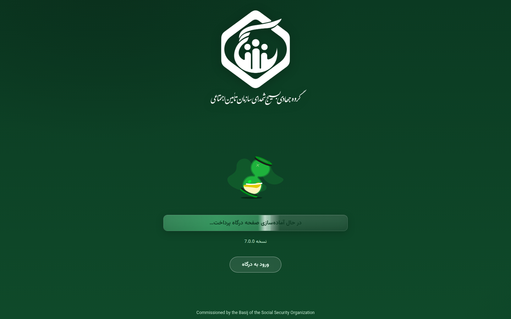
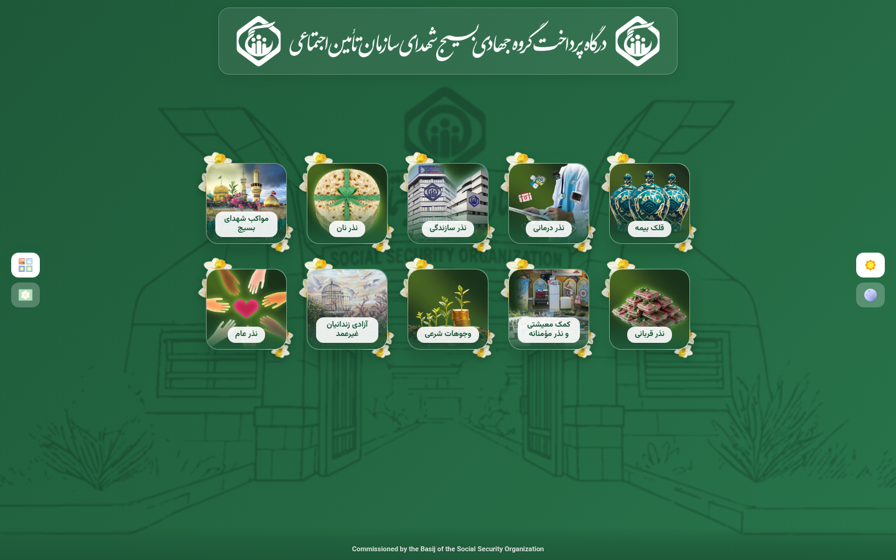
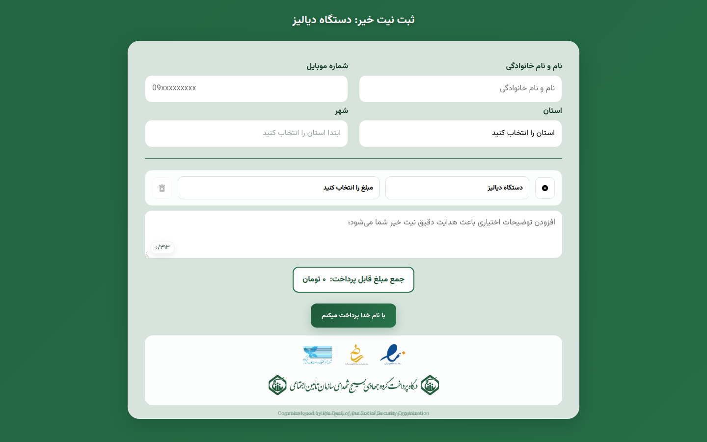

<div dir="rtl" align="center">


# 🌿 درگاه ثبت نیت خیر بسیج

<p>
  <strong>رابط وب فارسی و راست‌به‌چپ برای انتخاب نیت، ثبت اطلاعات و آماده‌سازی درخواست پرداخت</strong><br />
  <sub>نسخهٔ 7.0.0 · طراحی‌شده برای تجربه‌ای روشن، آرام و قابل اعتماد</sub>
</p>

<p>
  
  
  
  
  
</p>

<p>
  <a href="https://mahdi-arts.github.io/Basij-Tamin/"></a>
  <a href="https://github.com/Mahdi-Arts/Basij-Tamin"></a>
  <a href="#وضعیت-پرداخت"></a>
</p>

<p>
  <a href="https://mahdi-arts.github.io/Basij-Tamin/">🌐 مشاهدهٔ دمو</a> ·
  <a href="https://github.com/Mahdi-Arts/Basij-Tamin">📦 مخزن GitHub</a> ·
  <a href="https://github.com/Mahdi-Arts/Basij-Tamin/issues/new">🐛 گزارش خطا</a>
</p>

</div>

https://github.com/user-attachments/assets/f1fedb4b-a06b-4a36-ba79-789a6bd989f9

<div dir="rtl" align="center">
  <sub>ویدیوی مسیر کامل دمو با اطلاعات فرضی: 🌿 ورود ← 🎯 انتخاب نیت ← 🧾 تکمیل اطلاعات ← 💳 پرداخت آزمایشی</sub>
</div>

<p align="center">✨ ─── 🌿 ─── 🎯 ─── 🧾 ─── 💳 ─── ✨</p>

---

## فهرست مطالب

- [معرفی](#معرفی)
- [در یک نگاه](#در-یک-نگاه)
- [وضعیت فعلی](#وضعیت-فعلی)
- [قابلیت‌ها](#قابلیت‌ها)
- [مسیر کاربر](#مسیر-کاربر)
- [دموی زنده](#دموی-زنده)
- [درج در سایت سازمان](#درج-در-سایت-سازمان)
- [تصاویر صفحات](#تصاویر-صفحات)
- [وضعیت پرداخت](#وضعیت-پرداخت)
- [راه‌اندازی محلی](#راه‌اندازی-محلی)
- [ساختار پروژه](#ساختار-پروژه)
- [استفاده از نیت‌ها و URL](#استفاده-از-نیتها-و-url)
- [بازبینی و آزمون](#بازبینی-و-آزمون)
- [امنیت و حریم خصوصی](#امنیت-و-حریم-خصوصی)
- [مشارکت](#مشارکت)
- [مجوز](#مجوز)

## معرفی

این پروژه یک رابط وب فارسی و راست‌به‌چپ برای ثبت نیت‌های خیر است. مسیر کاربر از صفحهٔ آغازین به فهرست نیت‌ها می‌رسد؛ سپس اطلاعات تماس، استان، شهر، مبلغ و یک یا چند نیت ثبت می‌شود.

نسخهٔ فعلی برای نمایش و آزمون روی GitHub Pages منتشر شده است. پرداخت در این نسخه در حالت `demo` قرار دارد؛ بنابراین ثبت فرم به بانک یا درگاه واقعی متصل نمی‌شود و پس از نمایش پیام موفقیت آزمایشی، کاربر به صفحهٔ انتخاب نیت‌ها برمی‌گردد.

## در یک نگاه

<table>
  <tr>
    <td align="center" width="25%"><strong>🌱 ۴۰</strong><br /><sub>نیت نهایی</sub></td>
    <td align="center" width="25%"><strong>🎯 ۱۰</strong><br /><sub>کارت نیت</sub></td>
    <td align="center" width="25%"><strong>🗺️ ۳۱</strong><br /><sub>استان</sub></td>
    <td align="center" width="25%"><strong>🏙️ ۸۰۸</strong><br /><sub>گزینهٔ شهر</sub></td>
  </tr>
</table>

> 💡 اعداد بالا از دادهٔ واقعی `src/js/data.js` به‌دست آمده‌اند؛ شهرها در کنار استان انتخاب می‌شوند و نام‌های یکسان در استان‌های مختلف جداگانه باقی می‌مانند.

## وضعیت فعلی

| بخش | وضعیت |
|---|---|
| دموی زنده | فعال روی GitHub Pages |
| شاخه و مسیر دپلوی | `main:/` |
| حالت پرداخت | `demo` |
| تحلیل‌گر خارجی | فعال نیست |
| ابزار build | وجود ندارد؛ پروژه ایستا است |

## قابلیت‌ها

| قابلیت | نتیجهٔ قابل مشاهده |
|---|---|
| 🌱 منبع واحد نیت‌ها | کارت‌ها و فرم پرداخت از دادهٔ canonical در `src/js/data.js` استفاده می‌کنند. |
| 🧭 منوی چندسطحی | نیت‌های گروه‌بندی‌شده با کیبورد و منوی تودرتو قابل انتخاب هستند. |
| 🧾 ثبت چند نیت | چند ردیف نیت ساخته می‌شود و جمع مبلغ همان لحظه به‌روزرسانی می‌شود. |
| 🔄 همگام‌سازی وضعیت | تغییر نیت، مبلغ و گل مرتبط را بدون باقی‌گذاشتن state قبلی اصلاح می‌کند. |
| 🗺️ استان و شهر وابسته | فهرست شهرها پس از انتخاب استان از دادهٔ همان استان ساخته می‌شود. |
| 💰 مبلغ ثابت و دلخواه | مبلغ‌های آماده یا مبلغ دلخواه به تومان پشتیبانی می‌شوند. |
| ♿ دسترس‌پذیری مودال | فوکوس به مودال منتقل می‌شود؛ Tab در مودال می‌ماند و Escape آن را می‌بندد. |
| 🫧 جداسازی صفحهٔ زیرین | هنگام بازبودن مودال، صفحه blur و `inert` می‌شود و اسکرول آن متوقف می‌ماند. |
| 📱 طراحی واکنش‌گرا | فرم و کارت‌ها برای موبایل و دسکتاپ طراحی شده‌اند. |
| 🛡️ حریم خصوصی پیش‌فرض | ابزار تحلیل خارجی در صفحات بارگذاری نمی‌شود. |

## مسیر کاربر

<p align="center">🌿 ─── 🎯 ─── 🧾 ─── 💰 ─── 💳</p>

```text
🌿 صفحهٔ آغازین  →  🎯 انتخاب کارت و نیت  →  🧾 اطلاعات تماس و مکان  →  💰 مبلغ  →  💳 پرداخت آزمایشی
```

هر نیت نهایی مسیر کامل خود را حفظ می‌کند؛ بنابراین انتخاب از کارت، لینک مستقیم و فرم پرداخت به یک دادهٔ canonical می‌رسند.

## دموی زنده

<p align="center">🌐 ─── 🖥️ ─── 📦 ─── 🌐</p>

آدرس اصلی پروژه:

<https://mahdi-arts.github.io/Basij-Tamin/>

مسیر کوتاه پیشنهادی برای آزمون:

`🌿 ورود به درگاه` → `🎯 نذر درمانی` → `🩺 تجهیزات درمان` → `🧾 دستگاه دیالیز` → `💳 فرم پرداخت`

صفحات مستقیم:

- [صفحهٔ انتخاب نیت‌ها](https://mahdi-arts.github.io/Basij-Tamin/cards-form.html)
- [فرم پرداخت](https://mahdi-arts.github.io/Basij-Tamin/payment-form.html)

## درج در سایت سازمان

<p align="center">🧩 ─── 🏢 ─── 🔗 ─── ✨</p>

`index.html` و `cards-form.html` برای نمایش کامل دمو باقی می‌مانند. در صفحهٔ اصلی سازمان، فقط یک دکمه و اسکریپت زیر را درج کنید؛ ویجت کارت‌ها را مستقیماً زیر همان دکمه می‌سازد و با کلیک دوباره جمع می‌کند:

```html
<button type="button" data-basij-intents>🎯 نمایش نیات خیر</button>
<script
  src="https://mahdi-arts.github.io/Basij-Tamin/intent-widget.js?v=7.0.1"
  data-payment-url="https://mahdi-arts.github.io/Basij-Tamin/payment-form.html"
  defer>
</script>
```

کارت‌ها و منوهای چندسطحی با `Tab`، کلیدهای جهت، `Home`، `End` و `Escape` قابل استفاده‌اند. انتخاب نیت برگ نهایی در همان زبانه به `payment-form.html` منتقل می‌شود. برای اتصال به مسیر پرداخت سایت سازمان، فقط مقدار `data-payment-url` را به نشانی صفحهٔ پرداخت سازمان تغییر دهید؛ منبع نیت‌ها و دارایی‌های تصویری از همین نسخه خوانده می‌شوند.

برای مشاهدهٔ نمونهٔ صفحهٔ سازمان با همین روش، [نمونهٔ درج ویجت](https://mahdi-arts.github.io/Basij-Tamin/embed-demo.html) را باز کنید.

## تصاویر صفحات

<p align="center">🖼️ ─── ✨ ─── 🖼️</p>

تصاویر زیر از نسخهٔ زندهٔ پروژه در نمای دسکتاپ `1440×900` تهیه شده‌اند. برای مشاهدهٔ هر صفحه در دمو، روی تصویر مربوط کلیک کنید.

<div dir="rtl" align="center">
  <sub>ویدیوی مسیر کامل دمو در بالای README قرار دارد؛ تصاویر زیر نمای ثابت هر صفحه را نشان می‌دهند.</sub>
</div>

<table>
  <tr>
    <td align="center" width="33%">
      <strong>صفحهٔ آغازین</strong><br />
      <a href="https://mahdi-arts.github.io/Basij-Tamin/">
        
      </a>
    </td>
    <td align="center" width="33%">
      <strong>انتخاب نیت‌ها</strong><br />
      <a href="https://mahdi-arts.github.io/Basij-Tamin/cards-form.html">
        
      </a>
    </td>
    <td align="center" width="33%">
      <strong>فرم پرداخت</strong><br />
      <a href="https://mahdi-arts.github.io/Basij-Tamin/payment-form.html">
        
      </a>
    </td>
  </tr>
</table>

## وضعیت پرداخت

<p align="center">💳 ─── 🛡️ ─── ✅</p>

### حالت فعلی: `demo`

> [!IMPORTANT]
> این نسخه برای آزمون رابط کاربری است. فرم به بانک یا درگاه واقعی درخواست ارسال نمی‌کند و پس از نمایش پیام آزمایشی، کاربر به صفحهٔ انتخاب نیت‌ها برمی‌گردد.

پیکربندی فعلی در `src/js/payment-config.js` قرار دارد:

```javascript
window.PAYMENT_CONFIG = Object.freeze({
  mode: 'demo',
  createPaymentUrl: '',
  allowedRedirectOrigins: [],
  requestTimeoutMs: 15000
});
```

### آماده‌سازی اتصال واقعی

اتصال واقعی به backend سازمان نیاز دارد. برای فعال‌سازی آن:

- یک endpoint امن برای ساخت درخواست پرداخت فراهم کنید.
- مقدار `mode` را به `gateway` تغییر دهید.
- نشانی endpoint را در `createPaymentUrl` قرار دهید.
- origin معتبر درگاه را در `allowedRedirectOrigins` ثبت کنید.
- ساخت تراکنش، تبدیل واحد مبلغ، callback و verification نهایی را در backend انجام دهید.

نمونهٔ پیکربندی با نشانی‌های فرضی:

```javascript
window.PAYMENT_CONFIG = Object.freeze({
  mode: 'gateway',
  createPaymentUrl: 'https://api.example.org/payments/create',
  allowedRedirectOrigins: ['https://gateway.example.org'],
  requestTimeoutMs: 15000
});
```

مرورگر payload زیر را برای backend آماده می‌کند. مقدار `amount` بر حسب تومان است:

```json
{
  "amountUnit": "toman",
  "amount": 150000,
  "customer": {
    "fullName": "نام آزمایشی",
    "mobile": "09121234567",
    "province": "تهران",
    "city": "تهران"
  },
  "intents": [
    {
      "cause": "نذر نان",
      "title": "نذر نان",
      "amount": 150000
    }
  ],
  "notes": ""
}
```

backend باید payload را دوباره اعتبارسنجی کند و پس از ساخت تراکنش، JSON مشابه زیر برگرداند:

```json
{
  "redirectUrl": "https://gateway.example.org/payment/redirect-token"
}
```

`redirectUrl` فقط وقتی پذیرفته می‌شود که origin آن در allowlist ثبت شده باشد. merchant key، secret، token و اطلاعات حساس در کد مرورگر قرار نمی‌گیرند.

## راه‌اندازی محلی

<p align="center">🛠️ ─── 💻 ─── 🚀</p>

### پیش‌نیازها

- مرورگر به‌روز
- یک وب‌سرور ساده یا افزونهٔ Live Server
- `Python 3` فقط در صورتی که بخواهید وب‌سرور سادهٔ محلی اجرا کنید

### دریافت پروژه

```bash
git clone https://github.com/Mahdi-Arts/Basij-Tamin.git
cd Basij-Tamin
```

### اجرای محلی با Python

```bash
python3 -m http.server 4173
```

سپس این نشانی را باز کنید:

<http://127.0.0.1:4173/>

در VS Code نیز می‌توانید `index.html` را با Live Server اجرا کنید. پروژه به نصب package نیاز ندارد و در `package.json` فرایند build جداگانه‌ای وجود ندارد؛ script موجود فقط راهنمای اجرای پروژهٔ ایستا را چاپ می‌کند.

## ساختار پروژه

```text
Basij-Tamin/
├── index.html                 # صفحهٔ آغازین و لودینگ
├── cards-form.html            # کارت‌های انتخاب نیت
├── payment-form.html          # فرم ثبت اطلاعات و مبلغ
├── cards-scripts.js           # منطق کارت‌ها و منوهای کارت
├── payment-scripts.js         # منطق فرم، state و ارسال پرداخت
├── cards-styles.css           # استایل صفحهٔ کارت‌ها
├── payment-styles.css         # استایل فرم و مودال
├── intent-widget.js            # ویجت قابل درج در سایت سازمان
├── intent-widget.css           # استایل مستقل ویجت سازمانی
├── embed-demo.html             # نمونهٔ صفحهٔ سازمان با یک دکمه
├── package.json               # metadata و script راهنما
├── src/
│   ├── css/fonts.css          # فونت‌های مشترک
│   └── js/
│       ├── utils.js           # توابع مشترک
│       ├── data.js            # منبع واحد استان‌ها و نیت‌ها
│       └── payment-config.js  # تنظیمات عمومی اتصال backend
├── images/                    # کارت‌ها، لوگوها و تصاویر تزئینی
├── fonts/                     # فایل‌های Vazirmatn
├── docs/screenshots/           # تصاویر ثابت صفحات
├── docs/videos/                # ویدیوی مسیر کامل دمو
└── assets/vendor/             # دارایی محلی dotLottie
```

## استفاده از نیت‌ها و URL

کارت‌ها و فرم پرداخت از `src/js/data.js` استفاده می‌کنند. هر کارت یک `id` پایدار دارد و مسیر نهایی نیت از همان درخت داده ساخته می‌شود. برای جلوگیری از اختلاف بین کارت و فرم، `data-menu`، `data-url` و JSON تکراری در HTML نگهداری نمی‌شوند.

پارامتر `cause` باید یکی از نیت‌های نهایی درخت باشد، نه عنوان یک گروه. نمونهٔ معتبر:

```text
payment-form.html?cause=نذر_نان
payment-form.html?cause=نذر_درمانی_تجهیزات_درمان_دستگاه_دیالیز
```

در رابط کارت‌ها، URL با `URLSearchParams` ساخته می‌شود و در فرم دوباره با منبع canonical تطبیق داده می‌شود. نمونهٔ دوم به نیت «دستگاه دیالیز» می‌رسد و مسیر کامل خود را در `cause` نگه می‌دارد.

### افزودن نیت جدید

نیت جدید را فقط در `NIAT_CARDS_RAW` داخل `src/js/data.js` اضافه کنید و برای کارت‌های اصلی یک `id` یکتا تعیین کنید:

```javascript
const NIAT_CARDS_RAW = [
  { "id": "new-intent", "title": "نیت جدید" },
  {
    "id": "grouped-intent",
    "title": "نیت گروهی",
    "menu": [
      { "title": "گزینهٔ نخست" },
      { "title": "گزینهٔ دوم" }
    ]
  }
];
```

بعد از تغییر داده، URLهای برگرفته از نیت‌های برگ نهایی و عنوان کارت‌ها را بررسی کنید.

## بازبینی و آزمون

پروژه در حال حاضر test runner جداگانه ندارد. کنترل‌های پایهٔ زیر برای هر تغییر کدی پیشنهاد می‌شوند:

```bash
node --check payment-scripts.js
node --check cards-scripts.js
node --check src/js/data.js
node --check src/js/payment-config.js
git diff --check
```

در آخرین بازبینی این نسخه، موارد زیر کنترل شده‌اند:

- ۳۱ استان، ۸۰۸ گزینهٔ شهر، ۱۰ کارت و ۴۰ نیت نهایی؛
- یکتایی `cause`های نهایی؛
- ثبت دو نیت هم‌زمان و محاسبهٔ جمع مبلغ؛
- حفظ گل مشترک برای ردیف‌های دارای نیت یکسان؛
- reset شدن مبلغ و گل هنگام تغییر نیت؛
- focus trap، Escape، blur و `inert` در مودال؛
- نبود ارجاع به ابزار تحلیل خارجی و build جعلی؛
- باز و بسته‌شدن ویجت سازمانی با کلیک و کیبورد؛
- جابه‌جایی کارت‌ها و منوهای تودرتو با کلیدهای جهت، `Home`، `End` و `Escape`؛
- بارگذاری موفق صفحات اصلی روی GitHub Pages.

## امنیت و حریم خصوصی

- کلید پذیرنده، secret و token در frontend قرار نمی‌گیرند.
- endpoint پرداخت فقط با `POST` و payload JSON استفاده می‌شود.
- پاسخ درگاه باید `redirectUrl` معتبر داشته باشد.
- origin نشانی بازگشت با allowlist مقایسه می‌شود.
- در محیط HTTPS، endpoint و redirect نیز باید HTTPS باشند.
- مقدار مبلغ و نیت‌ها باید در backend دوباره اعتبارسنجی شوند.
- هیچ ابزار تحلیل خارجی در صفحات پروژه بارگذاری نمی‌شود.

حالت `demo` را پرداخت واقعی تلقی نکنید. پیش از انتشار رسمی، backend، sandbox provider، callback و verification باید جداگانه آزمون و تأیید شوند.

## مشارکت

برای پیشنهاد تغییر:

- مخزن را Fork کنید.
- شاخه‌ای با نام مشخص بسازید:

   ```bash
   git switch -c feature/short-description
   ```

- تغییر را محدود و قابل بازبینی نگه دارید.
- آزمون‌های پایه را اجرا کنید.
- commit روشن بنویسید و Pull Request باز کنید.

در تغییرات رابط کاربری، RTL، دسترس‌پذیری، موبایل و دسکتاپ را هم بررسی کنید. در تغییرات داده، یکتایی `id` و `cause` را کنترل کنید.

## مجوز

در `package.json` مجوز پروژه `MIT` اعلام شده است. متن مجوز مستقل در ریشهٔ فعلی مخزن قرار ندارد؛ برای توزیع رسمی، افزودن فایل `LICENSE` پیشنهاد می‌شود.

## قدردانی

این پروژه به سفارش و همت هیأت اندیشه‌ورز بسیج سازمان تأمین اجتماعی توسعه یافته است.

منابع استفاده‌شده:

- [Vazirmatn](https://github.com/rastikerdar/vazirmatn)
- [dotLottie Player](https://lottiefiles.com)

<div dir="rtl" align="center">

✨ ساخته‌شده با دقت و عشق توسط مهدی باغبان‌پور

🤲 ثواب این خدمت را با نهایت ارادت، به ساحت مقدس باب‌الحوائج، حضرت امام موسی بن جعفر الکاظم (عَلَيْهِ السَّلَامُ)، تقدیم می‌کنم.

</div>
